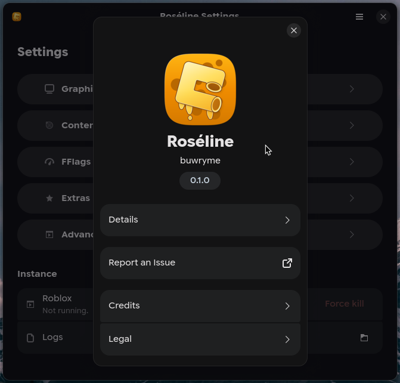
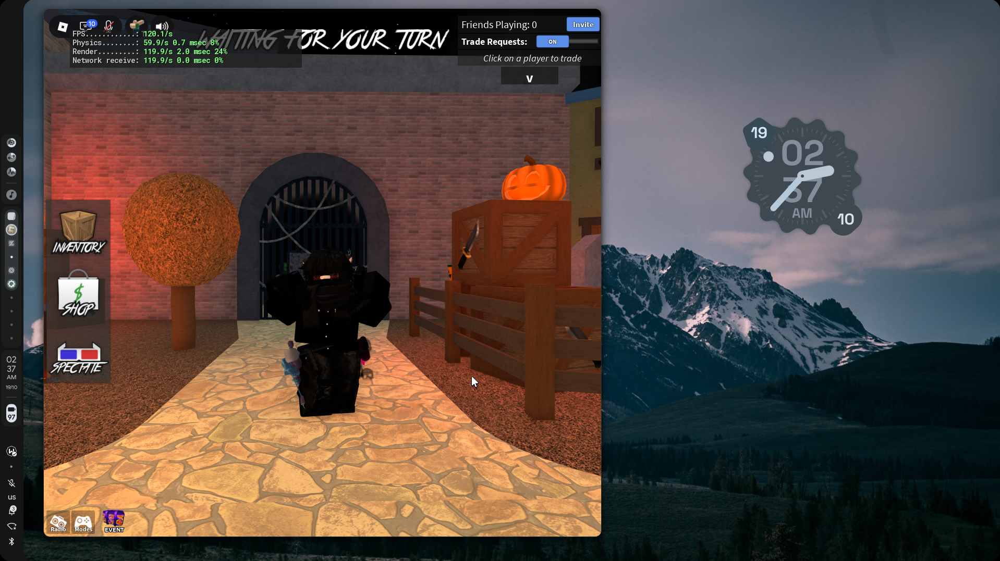
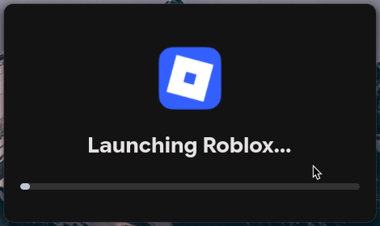

<p align="center">
  
</p>

<h1 align="center">Roséline</h1>

<p align="center">Roblox bootstrapper that runs the macOS builds of Roblox on Linux through <a href="https://github.com/microlift/rosemary">Rosemary</a>.</p>

<p align="center">
  <a href="https://git.buwryy.net/buwryy/Roseline">source</a> · <a href="https://git.buwryy.net/buwryy/Roseline/releases">releases</a> · <a href="https://discord.gg/HrUrzXAxPV">discord</a>
</p>


<p align="center">
  <table>
    <tr>
      <td valign="top" style="padding-right: 8px;">
        
      </td>
      <td valign="top" align="center">
        <br><br>
        
      </td>
    </tr>
  </table>
</p>

Roséline is a Linux-first Roblox bootstrapper that runs the macOS clients of Roblox using <a href="https://github.com/microlift/rosemary">Rosemary</a>. Usage is similar to <a href="https://sober.vinegarhq.org/">VinegarHQ's Sober</a>, but Roséline introduces lots more customizability, and is *fully* open source. ... oh and also it's written in Rust!!!

## Install

```sh
curl -fsSL https://roseline.buwryy.net/setup | bash
```

... or non-interactively:

```sh
curl -fsSL https://roseline.buwryy.net/setup | bash -s -- --system --version v0.1.3 --yes
curl -fsSL https://roseline.buwryy.net/setup | bash -s -- --flatpak --latest --yes
```

### Or, build manually:

```sh
git clone https://git.buwryy.net/buwryy/Roseline
cd Roseline
cargo build --release
```

then install system-wide under `/usr/local`:

```sh
sudo make install
```

...or per-user:

```sh
make install PREFIX=~/.local
```

## Cross-distro recipes

- `roseline.spec` - `rpmbuild -bb` against the `make dist` tarball
- `make-deb.sh`
- `PKGBUILD` - `makepkg` on Arch; or `make-arch.sh`
- `net.buwryy.Roseline.yml` — `flatpak-builder --user --install --install-deps-from=flathub`
- `make-appimage.sh`
- `../flake.nix` — `nix build .#`

**switching from a source install to a package**: run `make uninstall` first!!!

## Features

- Automatic client updates, from Roblox's own endpoint
- Server location notifications
- Graphics API and device choices
- Font overrides sorted by regular and monospace fonts; doesn't override language-specific and emoji fonts
- Content overlays (cursors, skyboxes, sounds, textures...)
- Runner management: choose Rosemary versions, reset the Darwin base, set modification policies for the Darwin base...
- Environment variables for Rosemary itself and Mac programs
- Optional Discord RPC, with Join/Show Game buttons and more
- Optional close when leaving a game
- View the location of the server you just joined
- Replace the avatar editor background with the classic one
- Bring your own Rosemary build
- Close Roblox when leaving game, removing homescreen
- Edit FastFlags
- ARM64 support (thanks to starraep!)
- Feral GameMode toggle

## Security

- Session cookies are stored using `libsecret`. Decrypted into plaintext during sessions only, whereas closing the game encrypts it back up and deletes the cookie.
  Existing cookies are migrated automatically. This feature is enforced, for more security.

## Note:

- Vulkan graphics might be slower than OpenGL due to the Metal2Vulkan translation layer
- Running Roblox on Rosemary is experimental and not as widely tested
- ARM64 Flatpak builds are omitted due to muvm requiring no sandboxes

## Credits

Rosemary and Butter by MicroliftHQ, which is what shaped Roséline

Bloxstrap, for the old avatar editor background

## Star history

<p align="center">
  <picture>
    <source media="(prefers-color-scheme: dark)" srcset="https://api.star-history.com/svg?repos=buwryme/Roseline&type=Date&theme=dark&nocache=1">
    
  </picture>
</p>

## License

Licensed GPL-3.0-or-later, with additional terms:
- Always keep the credit
- Never misrepresent a derivative as the original
- Zero warranty

<p align="center">made with ♡ by <a href="https://git.buwryy.net/buwryy">buwryy</a>. join the <a href="https://discord.gg/HrUrzXAxPV">discord server!</a></p>

<p align="center">for inquiries, contact hello@buwryy.net</p>