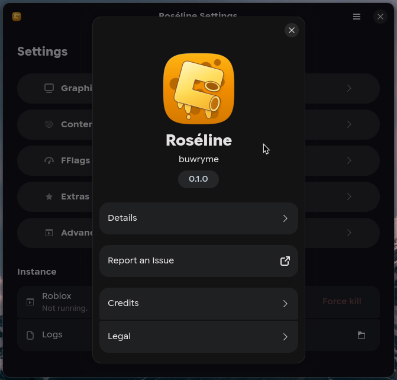
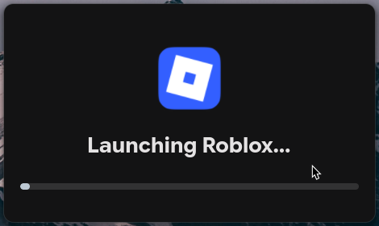
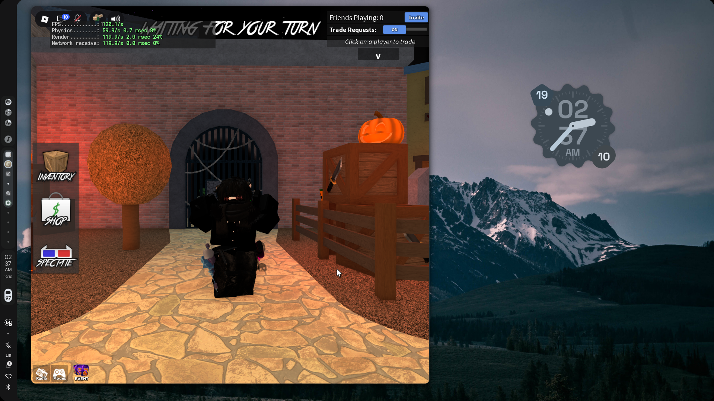

<p align="center">
  
</p>

<h1 align="center">Roséline</h1>

<p align="center">Run Roblox's macOS builds on Linux, through <a href="https://github.com/microlift/rosemary">Rosemary</a>.</p>

<p align="center">
  
  
  
  
  <a href="https://discord.gg/HrUrzXAxPV">
    
  </a>
</p>

Roséline is a small GTK4/Libadwaita app written in Rust that runs the macOS Roblox clients via Rosemary. 
Usage is similar to <a href="https://sober.vinegarhq.org/">VinegarHQ's Sober</a>, but Roséline introduces more customizability,
and is fully open source, from back-to-back.

## showcase

<p align="center">
  
</p>

<p align="center">
  
</p>

<p align="center">
  
</p>

## requirements

- Linux on **x86_64**
- a GPU with a working Vulkan driver (recommended), or a working OpenGL stack as the fallback
- more or less, 1GB of disk for the client, the runner and the base

## quick install

```sh
curl -fsSL https://buwryy.net/api/roseline/setup-script | bash
```

### non-interactive install:

```sh
curl -fsSL https://buwryy.net/api/roseline/setup-script | bash -s -- --system --version v0.1.1 --yes
curl -fsSL https://buwryy.net/api/roseline/setup-script | bash -s -- --flatpak --latest --yes
```

## from source

```sh
cargo build --release
sudo make install   # system-wide, under /usr/local
make install PREFIX=~/.local   # or per-user
```

`make install` refreshes the desktop database and makes Roséline the
default `roblox://` and `roblox-player://` handler. The config in
`~/.config/roseline` and the app data in `~/.local/share/roseline` never
travel with it; they are the user's, not the install's.

## packages

Every recipe builds from this tree and drops its artifact in `build/`.

```sh
sudo dnf install build/roseline-0.1.1-1.fc44.x86_64.rpm
sudo apt install build/roseline_0.1.1_amd64.deb
sudo pacman -U build/roseline-0.1.1-1-x86_64.pkg.tar.zst
./build/Roseline-0.1.1-x86_64.AppImage
tar -xJf build/roseline-0.1.1-x86_64.tar.xz -C /   # manual, /usr layout
```

The recipes live in `build-aux`:

- `roseline.spec` — `rpmbuild -bb` against the `make dist` tarball
- `make-deb.sh` — ar and tar alone, no Debian tooling needed
- `PKGBUILD` — `makepkg` on Arch; `make-arch.sh` assembles the same package elsewhere
- `net.buwryy.Roseline.yml` — `flatpak-builder --user --install --install-deps-from=flathub`
- `make-appimage.sh` — downloads its own appimagetool
- `../flake.nix` — `nix build .#`

Flatpak grants the Discord bridges' IPC sockets in the runtime directory.
If one lives somewhere else, Roséline offers the one-time
`flatpak override --user net.buwryy.Roseline --filesystem=xdg-run` on
launch.

switching from a source install to a package: run `make uninstall` first.
it removes the icons **and** refreshes the icon cache under `/usr/local`,
which otherwise keeps shadowing the package's icon.

## usage

- **Roséline** in your applications menu launches Roblox. 
  Updates or Rosemary download in the background, 
  then once everything is done setting up, Roblox opens.
- right click the entry (or use **Roséline Settings**, the separate entry
  for menus without actions) for the manager: graphics backend and GPU
  choice, text and monospace font picks, content overlays (cursor, textures,
  skybox...), the Rosemary runner with its MiniDarwin base, FFlags,
  environment variables...
- links to `roblox://` and `roblox-player://` install, so
  Play buttons on the website and private-server links work,
  since Rosemary (as of v0.3.0) doesn't supply a proper WebKit implementation 
  specifically Roblox can use.

## features

- automatic client updates from Roblox's own version endpoint
- Vulkan by default (Metal2Vulkan backed), OpenGL as a fallback
- GPU pickers for both paths, inspired from Butter's device selection
- text and monospace font overrides, leaving language and emoji fonts alone
- content overlays (cursors, skyboxes, sounds, platform textures)
  that re-apply on client updates
- Runner management: install, verify, repair, reset the Darwin base, and
  the read-only / warn / recover policy for system files
- Environment variables for both Rosemary itself, and the Roblox executable
- fast flags, locked to Roblox's own allowlist, written before each launch
- optional Discord Rich Presence, off by default; enable it on the setup screen or in Settings, with Join Game and View Game buttons; joins open through the browser so Flatpak Discord clients can hand off to Roblox
- only one instance can run to prevent potential bans!!!

## how it works

Roséline keeps its own copy of `RobloxPlayer.app`, fetched from
`setup.rbxcdn.com` through the same version endpoint the official client
uses. every launch checks for a newer version, swaps the copy when there
is one, re-applies the font overrides and content overlay, and hands the bundle to
[Rosemary](https://github.com/microlift/rosemary) with the settings from
the manager. The runner and the MiniDarwin base stick close to
[Butter](https://github.com/microlift/butter)'s mechanisms.

## known issues (please don't report those :<)

- Roblox's web surfaces (private server lists and any other in-client web pages) do not
  render yet. This is due to Rosemary not having implemented a good-enough WebKit that
  Roblox can use. Everything else (including login) works.
- x86_64 only
- the Metal2Vulkan path might introduce more performance overhead than OpenGL, but notably provides better graphics

> [!IMPORTANT]
> no modifications (whether it be exploits or such) to the client are done at all; only texture overrides that are optional.

## credits

Rosemary and Butter, the compatibility layer and its manager, are by the
Microlift contributors. Roséline can run only thanks to them. contributions to this project of any kind are welcome.

Licensed GPL-3.0-or-later. additional terms: keep the credit, never
present a fork as the original, absolutely no warranty. See [NOTICE](NOTICE) and
[LICENSE](LICENSE).

<p align="center">made with ♡ by <a href="https://github.com/buwryme">buwryme</a>. join the <a href="https://discord.gg/HrUrzXAxPV">discord server!</a></p>

for inquiries, contact hello@buwryy.net
